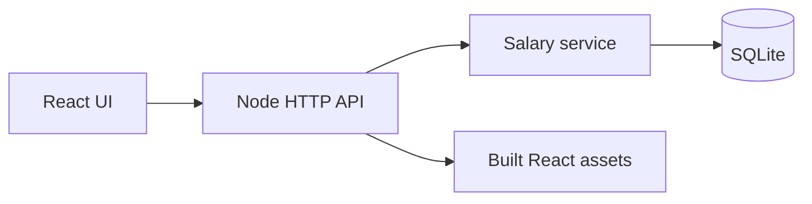

# Compwise — ACME salary management

[](https://github.com/anurickster/incubithrms/actions/workflows/ci.yml)

A React + Node.js application for an HR Manager to maintain annual base salaries and explore compensation across **10,000 fictional employees**, 10 countries, and 9 currencies. SQLite stores employee records, salary history, audit events, and retry responses.

**[Open the live app](https://compwise-acme-anurag.onrender.com)** — deployed on Render Free ($0/month).

The free service can take 50 seconds or more to wake after inactivity. Salary edits reset when the server restarts because SQLite uses temporary storage. All records are fictional. See [deployment and verification](docs/DEPLOYMENT.md).

**[Watch the demo](artifacts/demo/compwise-walkthrough.webm)** · [Requirements](docs/REQUIREMENTS.md) · [Architecture](artifacts/architecture.md) · [AI workflow](artifacts/ai-workflow-prompts.md)

All records are synthetic. There is no authentication or authorization, and “HR Manager” is a demonstration actor label. Use this app only with fictional data.

## Review the project in three minutes

| Try | What it demonstrates |
|---|---|
| [Overview](https://compwise-acme-anurag.onrender.com/?tab=overview) | 10,000 employees and salary benchmarks separated by currency |
| [Search a full name](https://compwise-acme-anurag.onrender.com/?tab=employees&q=Ethan+Nakamura) | Server-side search, filters, bounded pagination, and CSV export |
| [Germany + Engineering](https://compwise-acme-anurag.onrender.com/?tab=analytics&question=cohort&cohort_country=Germany) | A 58-person cohort with a matching directory drill-down |
| [Employee profile](https://compwise-acme-anurag.onrender.com/?tab=employees&employee=ACME-00042) | Salary edits, preserved history, validation, and a refreshable profile URL |
| [API health](https://compwise-acme-anurag.onrender.com/api/health) | The live backend and database are reachable |

Choose an untouched employee for a salary-edit demonstration. A second change on the same effective date is deliberately blocked. Salary medians can change when reviewers edit the public demo.

## What is implemented

| Capability | Engineering detail |
|---|---|
| Salary management | Positive bounded amounts, supported currencies, strict effective dates, and previous/new values in history |
| Reliable writes | Employee, history, audit, and keyed response share one transaction; write failures roll back |
| Safe retries | Keys bind the employee and normalized payload; identical retries replay and conflicts return 409 |
| Stale-edit protection | The browser sends the salary date it read; an outdated form receives 409 and can reload the latest salary |
| Compensation insights | Average, median, P25/P75, observed role ranges, dispersion, and country + department exploration |
| Directory and export | Shared literal substring/full-name filtering for the paginated directory and CSV; validated sort fields |
| Usable UI | Responsive components, loading/error/empty states, keyboard focus trapping, and URL state across refresh |
| Delivery evidence | Deterministic seeding, unit/API/helper tests, development and production browser checks, CI, benchmark, and a recorded demo |

## Architecture and choices



This is a modular monolith: one Node process serves the UI and API, while domain rules and database access remain separate modules. It is deliberately small enough to run and review without additional services.

| Choice | Reason | Trade-off |
|---|---|---|
| SQLite + native Node modules | Relational constraints, transactions, and simple local setup for 10,000 records | Synchronous DB calls and one service instance; larger concurrency needs measurement and another persistence design |
| Integer hundredths | Stable stored salary precision | Fixed two-decimal scale, including JPY, rather than per-currency minor-unit rules |
| Separate currency cohorts | Avoid invalid USD/INR totals | No global converted salary total without an agreed FX policy |
| Strict salary dates | Unambiguous current salary and dated history | Future scheduling and same-day corrections are outside this MVP |
| Free Render hosting | Public evaluation at $0/month | Cold starts and temporary hosted storage |

Detailed [decisions and limitations](artifacts/tradeoffs-and-decisions.md) are committed alongside the code.

## Run locally

Use **Node 22.22.3**, pinned in `.node-version` and `.nvmrc`. Node 20 cannot run the native `node:sqlite` backend. The supported Node range is 22.13–22.x; the pinned version is the one validated for this submission.

```sh
nvm use                 # optional, if nvm is installed
npm ci
npm run build
npm start
```

Open **http://127.0.0.1:8000**. The Node server serves both the built React UI and `/api`, and seeds the database on startup. Reseeding inserts only missing employees and preserves salary edits.

For frontend development, run `npm run api` and `npm run dev` in separate terminals, then open http://127.0.0.1:5173. Vite proxies `/api` to the backend. `SALARY_API_URL` can override the proxy destination.

| Setting | Default | Purpose |
|---|---|---|
| `PORT` | `8000` | HTTP port; Render supplies its own value |
| `HOST` | `127.0.0.1` | Set `0.0.0.0` on Render |
| `SALARY_DB_PATH` | `data/salaries.sqlite3` | SQLite path; free Render uses `/tmp/compwise/salaries.sqlite3` |
| `DEMO_EPHEMERAL_STORAGE` | unset | Set `true` to show the free-hosting reset notice |

`npm run seed` also runs the idempotent seed directly. To use an isolated database, set `SALARY_DB_PATH` before starting the API.

## Verify

```sh
npm test                       # 48 unit/API/helper tests; temporary isolated databases
npm run test:coverage          # native Node coverage; does not include React rendering
npm run build
npx playwright install chromium
npm run test:e2e                # browser workflows through the Vite proxy
npm run test:e2e:production     # the same workflows through the built Node server
npm run benchmark              # reproducible local service benchmarks
```

Tests cover exact statistical values, country + department scope, seeding, validation, stale-edit rejection/recovery, history/audit changes, atomic retry storage, conflicting idempotency requests, full-name/literal search, name sorting, and existing database migration. Browser checks cover salary updates, profile/cohort refresh, keyboard focus trapping/restoration, navigation, and directory drill-down. Automated browser tests use isolated data and a disposable browser; interactive checks use the requested Chrome profile.

[GitHub Actions](.github/workflows/ci.yml) runs the unit/API suite with native coverage reporting, the build, and both browser modes. Coverage reports do not include React rendering; those workflows are checked separately in the browser. A successful local run is separate from the remote CI result.

<details>
<summary>API and salary policy reference</summary>

## API

| Method | Endpoint | Behavior |
|---|---|---|
| GET | `/api/health` | Database readiness and employee count |
| GET | `/api/stats?country=Germany&department=Engineering` | All counts, percentiles, ranges, and groups scoped to both optional filters |
| GET | `/api/employees` | `q`, `country`, `department`, `currency`, `sort`, `direction`, `page`, `page_size` |
| GET | `/api/employees/export` | CSV matching `q`, `country`, `department`, `currency`; generated in memory |
| GET | `/api/employees/:id` | Employee and salary history |
| PATCH | `/api/employees/:id` | `base_salary`, `currency`, `effective_date`; optional `Idempotency-Key` header and `expected_salary_effective_date` field |

Valid sort fields are `employee_id`, `name`, `country`, `department`, `base_salary`, and `currency`. Salary sorting compares nominal amounts, so filter to one currency for a meaningful ranking. Page size is 1–100. Validation errors return 400, missing employees 404, conflicting retry keys 409, and database readiness failures 503. `/api/v1/*` aliases the unversioned routes.

The browser always sends `expected_salary_effective_date`, checked inside the write transaction. If another change has advanced the salary date, the API returns 409 and the dialog offers “Reload latest salary”. This field is optional for legacy API compatibility; other editing clients should send it too.

The browser retains a retry key for an unchanged salary submission after a failed response. The backend binds each key to the employee and normalized amount/currency/date. It writes the salary, history, audit event, and cached response in one transaction. Legacy cached keys without request fingerprints are rejected for safety; use a new key.

Effective dates use UTC, must advance the current salary date, and cannot be in the future. Salaries use fixed integer hundredths. Same-day corrections, future scheduling, and per-currency minor-unit exponents are outside this MVP.

</details>

## Deployment

The live [Render Free service](https://compwise-acme-anurag.onrender.com) runs Node 22.22.3 in Singapore. `npm ci --include=dev && npm test && npm run build` builds the app; `npm start` serves it. `/api/health` is the readiness check, and automatic deploys are off. Public source comes from this repository's `main` branch. Manual deployment is needed after code changes.

The hosted database path is `/tmp/compwise/salaries.sqlite3`. Free hosting loses local files on restart/redeploy/idle shutdown and may take about a minute to wake. The UI discloses this. [Render documents these limits](https://render.com/docs/free). See [configuration and live checks](docs/DEPLOYMENT.md) for the deployed version and evidence.

## Production boundaries and next steps

This assessment MVP has no SSO, role authorization, approval chain, real audit identity, or production backup/restore procedure. It does not calculate payroll, taxes, or benefits. Observed salary ranges and Max/Min do not establish pay equity.

The next priorities are durable hosted data and authenticated access, followed by salary revision/approval rules and a validated spreadsheet import with preview and row-level errors. This keeps the roadmap tied to HR's original spreadsheet problem.

## Design and evidence

- [One-page requirements](docs/REQUIREMENTS.md): goal, scope, acceptance, and exclusions. The original requirements were committed before implementation; later refinements remain visible in Git history.
- [Architecture](artifacts/architecture.md) and [trade-offs](artifacts/tradeoffs-and-decisions.md): implementation boundaries and limitations.
- [Performance methodology and results](artifacts/performance-analysis.md): measured locally, not hosting or load-test guarantees.
- [Test evidence](artifacts/test-evidence.md): executed commands, scoped coverage results, and regression scenarios.
- [AI workflow notes](artifacts/ai-workflow-prompts.md): how AI-assisted work was checked and corrected.
- [Submission checklist](docs/SUBMISSION.md), [deployment evidence](docs/DEPLOYMENT.md).

`npm run demo:video` regenerates `artifacts/demo/compwise-walkthrough.webm` using a disposable database. The recording is an automated walkthrough without voice narration.
