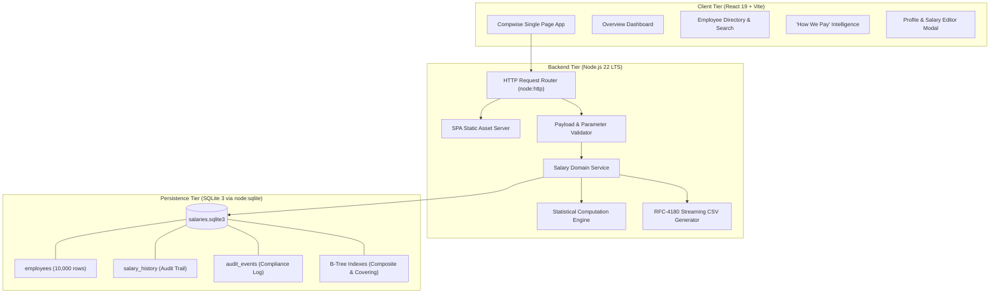
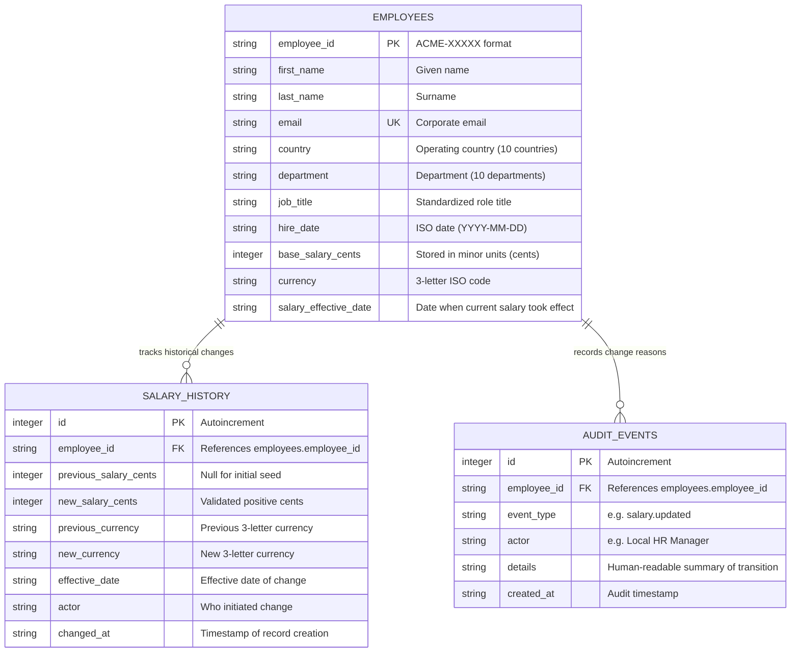
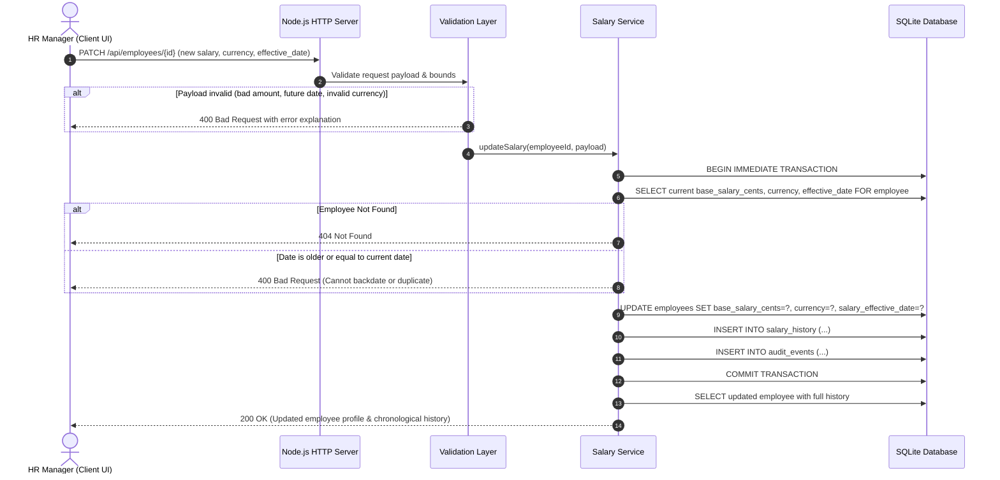

# Compwise System Architecture

## 1. High-Level System Architecture

Compwise is built as a modular, local-first enterprise compensation platform designed to process 10,000 employee records with sub-millisecond query responses and zero external service dependencies.

---

## 2. Database Schema & Entity Relationship

---

## 3. Salary Mutation Workflow & Transaction Boundary

To guarantee zero data loss, the salary update workflow enforces transactional atomicity across three database tables:

---

## 4. API Specification

| Method | Endpoint | Query Parameters | Description |
|---|---|---|---|
| `GET` | `/api/health` | None | Service readiness probe |
| `GET` | `/api/stats` | `country`, `department` (optional) | Returns org-wide and cohort compensation statistics (P25, median, mean, P75, min, max, headcount) |
| `GET` | `/api/employees` | `q`, `country`, `department`, `currency`, `sort`, `direction`, `page`, `page_size` | Paginated search and faceted filter across 10,000 employees |
| `GET` | `/api/employees/export` | `q`, `country`, `department`, `currency` | Streamed RFC-4180 compliant CSV export for HR reporting |
| `GET` | `/api/employees/:id` | None | Fetch employee record with full chronological salary history |
| `PATCH` | `/api/employees/:id` | None | Atomic effective-dated salary update with audit trail |
