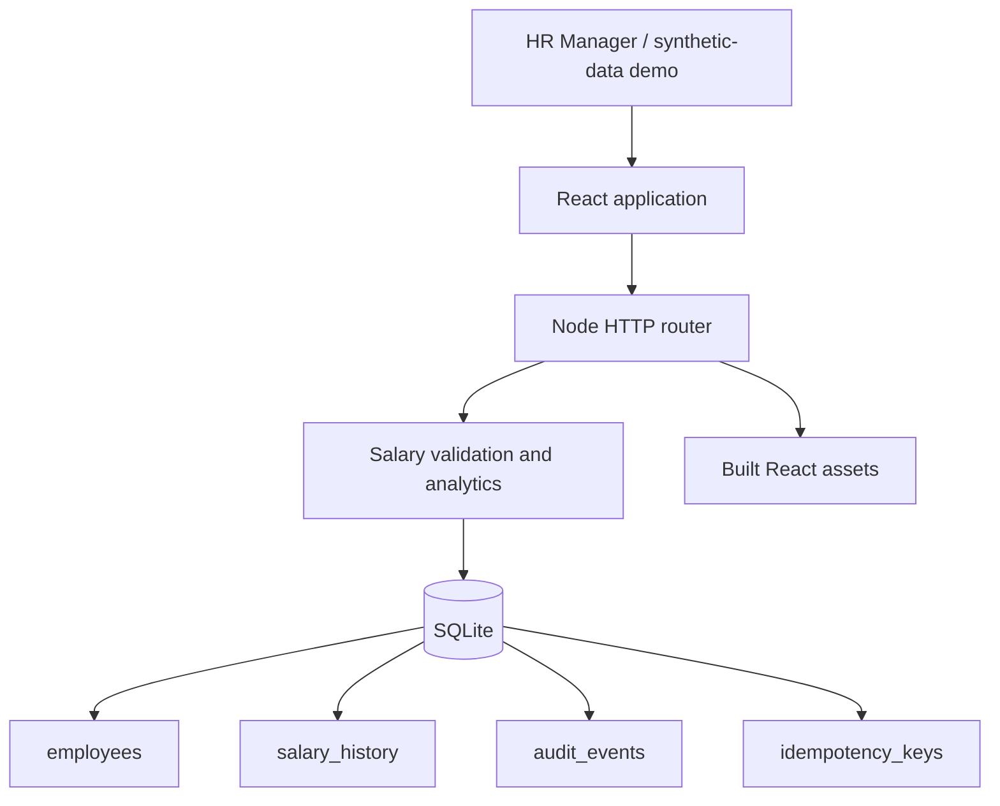

# Compwise architecture



React components separate the overview, directory, analytics, and salary dialog. Shared URL/date helpers are imported by both the app and helper tests. Cohort selection fetches scoped statistics with cancellation; outdated responses cannot replace the selected cohort. Employee profile IDs are retained while loading, so URL synchronization does not discard deep links.

`server.js` handles HTTP routing, JSON bodies, static assets, response headers, readiness, and shutdown. `service.js` validates domain inputs, reads employees, computes salary distributions, exports CSV, and coordinates salary mutations. `database.js` owns schema initialization, migration, and cached synchronous handles. `seed.js` generates deterministic fictional employees.

## Salary transaction

```mermaid
sequenceDiagram
  participant UI as HR browser
  participant API as Node API
  participant DB as SQLite
  UI->>API: PATCH employee + payload + retry key
  API->>API: Validate and normalize amount/currency/date
  API->>DB: BEGIN IMMEDIATE
  API->>DB: Read retry key
  alt Existing key matches employee and request
    DB-->>API: Original response
    API->>DB: COMMIT
  else New key
    API->>DB: Read current salary; compare expected date and validate change
    API->>DB: Update employee
    API->>DB: Insert history and audit event
    API->>DB: Insert key, normalized request, and response
    API->>DB: COMMIT
  end
  API-->>UI: Updated profile / original response
```

A conflicting key or stale expected salary date returns 409 without mutation. The browser always supplies its originally read salary date and offers a reload action for conflicts. An error in any write rolls back the transaction. Existing keys without a request fingerprint are retained but cannot replay. History/audit records are append-only through the application API; this is not a tamper-proof database or authenticated audit system.

## Statistics and deployment

Every statistics query applies optional country and department filters to counts and salary rows. Values are sorted within each currency. Linear interpolation computes P25, median, and P75; integer hundredths are rounded at the output boundary. Country benchmarks include all departments; selected-cohort statistics apply both filters. Multiple currencies are always displayed separately.

One Node process serves the UI and API on the same origin. The Render configuration uses a single free service with temporary SQLite storage, runtime seeding, and a database readiness endpoint. Salary edits reset on hosted service restart; the UI discloses this. Local deployment can use a durable filesystem, and a paid persistent disk would remove this particular reset limitation.
